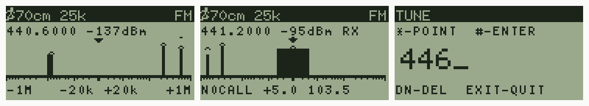
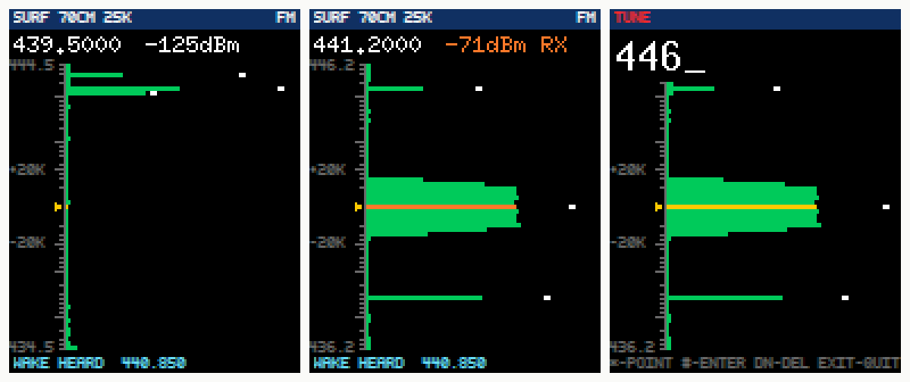
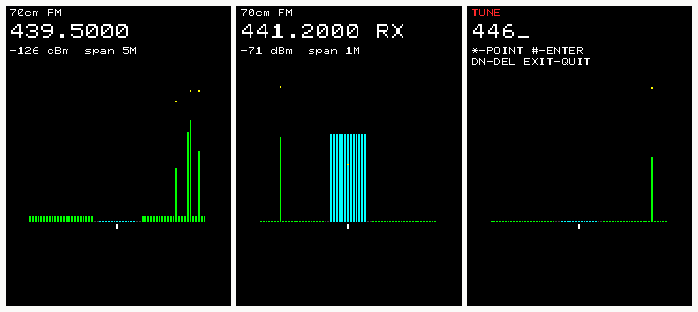
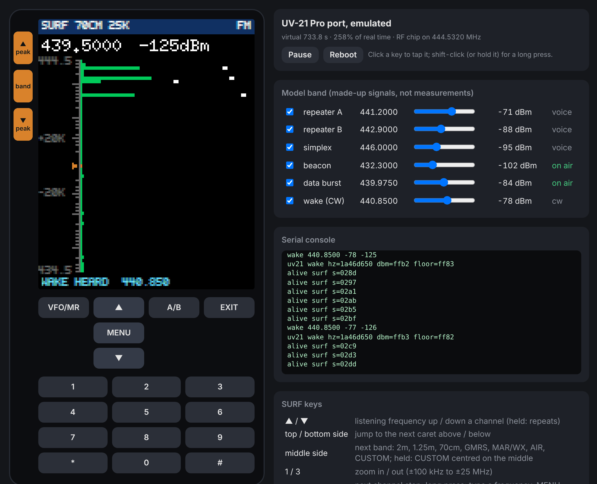

# blowfang

Alternative firmware for cheap handheld radios, built around two ideas: **SURF**, a live bar graph
of the band you tune by ear, and **sotto**, an open low-rate voice codec
([baitisj/sotto](https://github.com/baitisj/sotto)) carried over FM, DMR ("DSotto"), C4FM
("FuSotto") and M17 ("M17-sotto"). Each radio builds on the open firmware that already exists for
it, and everything is emulated and tested on a PC before it goes near a radio.

```sh
git clone --recurse-submodules https://github.com/baitisj/blowfang
```

**Have a UV-K6 and want to run this?** Read [`docs/manual/install.md`](docs/manual/install.md):
one script and the programming cable, no second radio. The same installer runs in Chrome or Edge
with no Python: [`web/k6-installer/`](web/k6-installer/).

## Radios

| Radio | Chips | Based on | State | Where |
|---|---|---|---|---|
| Baofeng UV-K6 / K61 | KD32F328 (Cortex-M0), FD6818 (BK4819 family) | [Aura](firmware/k6-aura/) (Rust, GPL-3) | Runs on a radio. The sotto voice pager, EXPLORE, the sotto ARENA, FuSotto send and receive, DMR send, an IF receiver and softmodem, and a library of signed RAM modules loaded over the air (SURF, FT8, WSPR, AIS, APRS clock, DMR detect, CW ID, Morse, MIDI, GROUNDWAVE and more) | `c/k6/`, `firmware/k6-aura/`, `docs/k6-*.md` |
| TYT MD-UV380 / MD-UV390 / RT3S | STM32F405, AT1846S, HR_C6000 | [OpenRTX](firmware/uv380-openrtx/) (GPL-3), and a bare-metal port for QEMU | Runs on a radio: one multi-mode image that sends and receives sotto over M17, DMR and C4FM, plus the PAGER mode that talks to the K6. No SURF yet | `firmware/uv380-openrtx/`, `radios/uv380/`, `docs/uv380-*.md` |
| Baofeng UV-21 Pro | AT32F421, BK4829 | [bf-5rh-firmware-open](radios/uv21/fw/) (Rust, GPL-3) | Runs on a radio. A lean port: **SURF is the only screen**, receive only, the SPI flash read only, hands-free reflash. Listens for the CW wake on 440.850 MHz while it surfs | `radios/uv21/`, `sim/uv21/`, `docs/uv21-characteristics.md` |
| Radtel RT-950 Pro | AT32F403A, two BK4829 | [jaymart1983's firmware](radios/rt950/) (GPL-3) | Built for the radio and tested against a PC model of both chips; **not run on a radio yet**. Two-chip SURF (one chip sweeps while the other listens) and FT8 / WSPR transmit by PLL steps | `radios/rt950/`, `docs/rt950-*.md` |

Each radio keeps a characteristics document with what has been measured on it:
[K6](docs/k6-characteristics.md), [UV-380](docs/uv380-characteristics.md),
[UV-21 Pro](docs/uv21-characteristics.md), [RT-950 Pro](docs/rt950-characteristics.md).

## SURF

SURF sweeps the band and draws it as 63 bars on a "lens" scale: the listening frequency always in
the middle, fine bins (2.5 kHz) close to it and wider ones further out, so a +-1 MHz screen still
shows the channels next to you. It listens first and sweeps only while the middle channel is
quiet, and parks and plays when a signal comes up. Every peak it hears gets a caret that rises
each time the peak is heard again and falls back with time, so a station that keyed up a minute
ago is still on the screen, and the side keys jump from caret to caret. The scale, the sweep, the
floor, the carets and the jumps are one shared core, [`c/common/surf_core.inc`](c/common/surf_core.inc);
each radio adds its screen, its keys and how its receiver is driven.

The screens below come from the emulators, on a made-up band (no recording, no real station):

**UV-K6** (a RAM module, `c/k6/mod/surf.c`; the whole manual is [docs/k6-surf.md](docs/k6-surf.md)).
Left to right: +-1 MHz round 440.600 with three carets; the side key has jumped to a repeater the
explorer saved, so the bottom line shows its call, offset and tone; TUNE, typing 446.



**UV-21 Pro** (its main screen, `radios/uv21/surf/uv21_surf.c`). The tall screen turns SURF on its
side, higher frequencies at the top. Left to right: +-5 MHz with the carets of five stations;
the top side key's jump to a repeater playing (RX); TUNE, typing 446. WAKE HEARD on the bottom
line is the CW wake on 440.850 MHz, heard while it surfed.



**RT-950 Pro** (`radios/rt950/src/surf2.c`). Chip 1 sweeps all the time and chip 0 listens, so
the audio never stops for a sweep; chip 0's own level fills the cyan bins round the middle. These
frames are the glue's drawing code (`port/jm_glue.c`, with the base firmware's 8x8 font) run on a
PC on frames from `radios/rt950/sim/rt950_sim.c`: the layout is the one the radio will draw, but
nobody has seen it on an RT-950 yet.



### SURF keys

The same rules on every radio where the keys exist (the UV-21's, from 2026-11-24):

| Key | Does |
|---|---|
| UP / DOWN | the listening frequency one channel up / down (held: repeats) |
| side keys | jump to the next caret above / below (UV-21: top side key up, bottom down) |
| BAND (UV-21: middle side key) | next band: 2m, 1.25m, 70cm, GMRS, MAR/WX, AIR, CUSTOM. UV-21: held, CUSTOM is centred on the middle |
| # held (K6: also V) | **TUNE**: type a frequency in MHz, `*` is the point, `#` enters (`446#` is 446.000), DOWN deletes, EXIT quits. CUSTOM is then centred there, as wide as the band was (2 to 16 MHz) |
| # | the next channel step |
| 1 / 3 | zoom in / out, +-100 kHz to +-25 MHz |
| 4 | the demodulator: FM, DSB, AM |
| 5 | the band's centre |
| 7 / 9, 8 | fixed gain down / up; the receiver's own AGC |
| A/B | how fast the carets fall: 1 min, 5 min, 20 min, 15 s |
| `*` | **MON**: the squelch open, the chip's too. UV-21: the sweeps and the carets go on, so the audio hushes for each refresh sweep (one receiver). RT-950: the listener stays open while chip 1 sweeps. K6: no sweeping while MON is on |
| 0 | **HOLD**: UV-21: no retunes at all, the carets stay put, the middle listens with the squelch as usual (MON and HOLD are independent). RT-950: chip 1's sweep stops. K6: no refresh sweeps while a signal plays |
| MENU | says the middle's frequency and level on the serial line (UV-21: held, the CW wake listens on the middle's frequency) |
| EXIT | leaves TUNE or a typed range; then, on the K6 and the RT-950, SURF itself (on the UV-21 SURF is the only screen) |

## Try it without a radio

The UV-21 workbench runs the real UV-21 Pro image in an emulated AT32F421 (Unicorn) in a browser
page: the radio's screen, a faceplate you can click or drive from the keyboard, the serial console,
and a made-up band of stations you can switch on and off or turn up and down. See
[sim/uv21/README.md](sim/uv21/README.md).

```sh
python3 -m sim.uv21                     # builds the image, then open http://127.0.0.1:5057/
```



**SoapyFang** ([sim/soapyfang/README.md](sim/soapyfang/README.md)) puts real or recorded I/Q
behind an emulated BK48xx RF chip, so the same emulated firmware hears real signals: a Pluto, an
RTL-SDR or anything SoapySDR opens, a SigMF recording, or the synthetic band. Receive only.

```sh
python3 -m sim.soapyfang --source soapy:driver=rtlsdr --gain 30    # then http://127.0.0.1:5058/
```

The K6 has its own emulation in the tests (`tests/test_k6_*.py` run its modules on an emulated
Cortex-M0 with a model of the FD6818), and `tools/k6_screen.py` draws a module's screen as the
radio shows it; the RT-950's two chips are modelled in `radios/rt950/sim/rt950_sim.c`; the
UV-380's OpenRTX image runs in OpenRTX's Linux emulator, and the bare-metal port in QEMU.

## The bench

The radios live on a test bench run by one host. Everything that touches them (builds, flashes,
module uploads, Pluto SDR and IC-7100 sends, serial loggers) goes through one queue,
[`tools/bench_runner.py`](docs/bench-runner.md), which runs jobs one at a time and checks the
bench rules in code: transmit only inside 430-450 MHz and the job's claimed channel, low power,
keyed images and signed modules only, and every test transmission carries its CW ident. Jobs can come from a checkout on the host or through an inbox
branch (`tools/bench_inbox.py`). The ADALM-Pluto SDR is the standard test transmitter and receiver
([docs/pluto-bench.md](docs/pluto-bench.md), `tools/pluto_*`).

## Where things are

- `c/common/`: portable C shared by radios: the SURF core (`surf_core.inc`), K6 pager packets
  and FFSK, the sotto receiver, range test, tone FSK
- `c/k6/`: the K6 C library (pager reassembly and playback, IF receiver, module loader) and its host builds
- `c/k6/mod/`: the K6 RAM modules, one file each; `docs/k6-modules.md` is the module API
- `firmware/k6-aura/`: the patch on Aura and `build.sh`, which builds the K6 images
- `firmware/uv380-openrtx/`: the patch on OpenRTX for the UV-380 (PAGER and the multi-mode sotto image)
- `radios/uv380/`: the bare-metal TYT MD-UV380 port (STM32F405), built for the radio and for QEMU
- `radios/uv21/`: the UV-21 Pro: the firmware port (`fw/`), SURF (`surf/`), RAM modules (`mod/`),
  and the dumper and bring-up images used to back up the stock firmware first
- `radios/rt950/`: the RT-950 Pro: two-chip SURF, FT8 / WSPR transmit, the glue to the base
  firmware, the backup tools and the two-chip model
- `modem/`: the Python side: K6 packets and FSK (`modem.k6`), modules (`k6mod`), PSK31, APRS, CI-V PTT
- `sim/k6if/`, `sim/k6digi/`: models of the K6's IF path and digital modes
- `sim/uv21/`: the UV-21 workbench; `sim/soapyfang/`: SDR I/Q into an emulated RF chip
- `tools/k6_*`: K6 bench tools (`k6_update.py` flashes, `k6_install.py` installs, `k6_bench.py`
  owns the PTT lock and CW ID keeper); `tools/uv380_*`, `tools/uv21_*`: the other radios'
- `tools/bench_*`, `tools/pluto_*`: the bench runner and the Pluto SDR tools
- `web/k6-installer/`: the K6 installer in the browser (Web Serial)
- `tests/`: host and emulated tests; `tests/data/k6/air/` holds on-air logs replayed in CI
- `docs/`: design notes and bench results, one per subsystem (`docs/k6-*.md`, `docs/uv380-*.md`,
  `docs/rt950-*.md`, `docs/uv21-*.md`); `docs/img/` their pictures
- `docs/manual/`: manuals for using things on the radio: `install.md`, the instruction book for
  putting blowfang on your own K6 over the programming cable; `midi-player.md`, the MIDI player

## The sotto codec

The voice codec lives in [baitisj/sotto](https://github.com/baitisj/sotto) and is a git
submodule at `sotto/`, pinned to one sotto commit. The K6 build compiles sotto's fixed-point
sources itself with its own flags, so `c/fixed` and the few `c/sotto_*` headers it uses are
symlinks into the submodule:

- `c/fixed`
- `c/sotto.h`
- `c/sotto_internal.h`
- `c/sotto_lr_dec.inc`
- `c/sotto_lr_tables.h`
- `c/sotto_vlr.h`
- `c/sotto_vlr_dec.inc`
- `c/sotto_vlr_tables.c`
- `c/sotto_vlr_tables.h`

To take a newer sotto: `git -C sotto checkout <commit>`, then commit the `sotto` pointer. The
weekly CI run also tests against sotto main, so a codec change that breaks the K6 shows up early.
Where the docs say `c/sotto_enc` or `c/sotto_dec`, build them with `make -C sotto` and run
`sotto/c/sotto_enc`.

## Build and test

```sh
make -C sotto/c VARIANT=v3.7 fixed PYTHON=false   # the codec's host decoders the tests use
make -C c/k6                                       # the K6 library's host builds
python -m pytest -q -n auto tests/                 # needs numpy scipy soundfile pytest pytest-xdist unicorn capstone (CI adds pytest-split)
sh firmware/k6-aura/build.sh                       # the radio images (Rust + clang/lld); see its README
```

CI (`.github/workflows/k6-firmware.yml`) runs the same and keeps each image as an artifact.

### Iterating quickly

While working on one area, run only its test file; most finish in seconds:

```sh
python -m pytest -q tests/test_k6_air.py tests/test_k6_air_cases.py   # on-air recordings, about 2 s
python -m pytest -q -n auto tests/test_k6_ifpager.py                  # an emulated-M0 module, about 1 min
python -m pytest -q -k "not on_m0 and not emulated" tests/test_k6_ifrx.py   # skip the emulated sessions
```

CI splits the host tests into four shards that run side by side, so a full run takes about
2.5 minutes. Each shard's share comes from `tests/durations.json` (pytest-split). A new test
counts as average until that file is refreshed, so after adding a test that takes more than
about 20 s, refresh it:

```sh
python -m pytest -q -n auto --store-durations --durations-path tests/durations.json \
    $(grep -o 'tests/test_[a-z0-9_]*\.py' .github/workflows/k6-firmware.yml)
```

### CI: only the radios a change touches

Each radio has its own workflow: `k6-firmware.yml`, `uv380.yml`, `uv380-openrtx.yml`,
`rt950.yml` and `uv21.yml`. On a pull request, each one first asks `tools/ci_scope.py` whether the change
touches that radio, using the map in `.github/ci-radios.txt`. If it doesn't, the radio's jobs
show as skipped, which counts as passed. Shared code (the sotto submodule, `c/common/`, the
shared `modem/` files) builds every radio that uses it.

The Pluto SDR and hamlet bench runner tools (`tools/pluto_*`, `tools/pluto_chan/`,
`tools/bench_*` and their tests) are the map's `[bench]` section. A change there runs only
`bench-tools.yml`, about a minute of plain Python tests, and no radio's firmware build. A new file
named like those lands in `[bench]` with no new map line.

A change that touches only docs (the map's `[ignore]` section) starts no radio workflow at all,
on a pull request or on a push to main: each radio workflow's `paths:` filter is `[ignore]`
turned inside out. `python3 tools/ci_scope.py --paths` prints that list, and `--check` (the
Forbidden files job) fails if a workflow's copy differs from the map. Only the guard workflow
runs on a docs-only change.

A push to main (a merge) is scoped the same way, by what the push changed (its before..after),
so merging simulator work doesn't rebuild the K6, UV-380 and RT-950 firmware. A push whose change
can't be worked out, a forced push, every pushed tag (cutting a release always runs full CI), the
weekly run, "Run workflow" on any branch, and a PR with the `ci-full` label (add it, then re-run
the jobs) build everything. A file the map doesn't place builds every radio.

Since the newest main run may have skipped a radio, the images hamlet flashes come from that
radio's last main run that built it:

```sh
python3 tools/ci_artifact.py uv21                 # run, commit, artifacts and gh download commands
python3 tools/ci_artifact.py k6 --name aura --download /tmp/k6   # fetch with gh
```

To see what your branch will build, and to check the map after adding files:

```sh
python3 tools/ci_scope.py            # which radios this branch's PR builds (against origin/main)
python3 tools/ci_scope.py --check    # every file placed; each radio's imports and #includes listed
```

The Forbidden files workflow runs `--check` on every PR. It fails when a new file is in no
section, when a line matches nothing after a rename, or when a radio's tests import (or its C
`#include`s) a file missing from that radio's section. Its message names the line to add.

## History

This repository was split out of baitisj/sotto on 2026-11-09 with `git filter-repo`, keeping
every commit that touched these files. Pull requests up to #173 are in
[baitisj/sotto](https://github.com/baitisj/sotto/pulls?q=is%3Apr). Commit IDs changed in the
split: images flashed before it report sotto commits as their build ID, and
`docs/sotto-commit-map.txt` maps each old sotto commit to its blowfang commit.

## Never committed here

- K6 bootloader dumps (`boot.bin`)
- Yaesu firmware or decrypted images
- module signing keys (`k6-mod.key`)
- built images (`.bin`, `.elf`, `libsotto_k6.a`): CI keeps them as artifacts

The *Forbidden files* workflow fails a push or PR that adds one.

## Licence

MIT (`LICENSE`), except where blowfang builds on GPL-3 firmware:

- `firmware/k6-aura/aura-pager.patch` is GPL-3.0 like Aura, the firmware it patches
  (`firmware/k6-aura/LICENSE.md`), and so are the Aura images CI builds;
- `firmware/uv380-openrtx/` patches OpenRTX and is GPL-3.0-or-later like it;
- `radios/rt950/` is GPL-3.0-or-later ([radios/rt950/LICENSE](radios/rt950/LICENSE)), so it can
  build on jaymart1983's firmware;
- `radios/uv21/fw/` is bf-5rh-firmware-open moved onto the UV-21 Pro, GPL-3
  ([radios/uv21/fw/LICENSE](radios/uv21/fw/LICENSE)); the rest of `radios/uv21/` is MIT.

The shared C in `c/common/` stays MIT, so every radio can use it. `c/k6/ft8/ft8k_tables.h` is
generated from ft8_lib (MIT).
