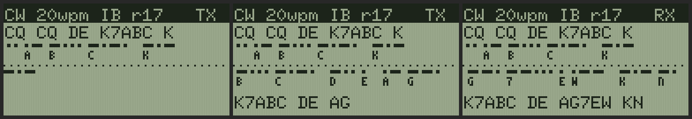

# K6 Morse RTX

A RAM module for the Baofeng UV-K6 (`c/k6/mod/morse.c`, MIT) that receives Morse and draws it
on a scrolling tape, and sends Morse from the two orange side keys used as paddles. Jeff asked
for it on 2026-11-08: "receives and graphically draws dits and dahs on a scroll on the screen;
use the two orange side buttons as morse paddles to transmit".

Status: built and tested on an emulated Cortex-M0 with the keypad modelled at the GPIO pins
and a modelled operator on the paddles (`tests/test_k6_morse.py`, in CI). Not on the radio yet.
It is 5.4 KB of code, so it needs the shared RAM block of PR #142 (modules up to 9,736 bytes);
on the 4 KB images it doesn't load.



## The screen

```
 CW 20wpm IB r18   RX      title bar: send speed, keyer mode, speed heard, state
 CQ CQ DE K7ABC K          the text received (the last 21 characters)
 .. -.- .- -..             receive tape: each mark as it ends (dit 2 px, dah 6 px),
  C  Q   D  E              the letter under it once the character's gap comes
 . . . . . . . . . . .
 -.- --... .-               send tape, the same for what the keyer sent
  K   7    A
 K7ABC DE AG7EW KN         the text sent
```

The tapes are the module screen's waterfall rows (API level 6, 29 rows of 128 pixels): the
receive tape on top, a dotted line, the send tape below. Each moves left 32 pixels when its
next mark would run off the right edge. The letters use a 3x5 font in the module (43 glyphs,
86 bytes: A-Z, 0-9, `/ ? = . , +`, and `*` for a code it doesn't know).

State: `RX` listening (paddles key up), `TX.` keying up, `TX` sending, `ID` sending the ident,
`PR` practice (the paddles drive the keyer, the sidetone and the send tape, but no transmitter).
Keyer mode: `IB` iambic B, `IA` iambic A, `SK` straight key.

A frame takes 20-40 ms to draw and send, and nothing else runs meanwhile. So the module never
starts one inside the keyer's last 45 ms of a mark or gap, nor while a key change is being
debounced. On receive it draws just after a key change, when the next one is at least 40 ms
away (after a key-down: a dot plus the detector's lag, under 37 wpm; after a key-up: a dot less
the lag, under 23 wpm), or after a second of quiet. Faster than that, the receive tape catches up
in the pauses.

## Receive

The FD6818's tone detector, set up as `cwlisten` and EXPLORE's Listen for ID set it up
(`c/k6/tonedet.h`: 16 tones from 400 to 1300 Hz in 60 Hz steps, REG_0B bit 12), polled every millisecond,
debounced 8 ms with the edges back-dated, and the detector's ~10 ms lag taken off each mark.
It hears MCW: a tone keyed on an FM carrier, as `wsprtx`'s ID and this module's own sending.
Carrier-keyed CW (`cwkey`) doesn't trigger the tone detector.

The decoder is a real-time one, so the letter appears as soon as its gap does. (`cwid.c`, the CW
ID decoder, decodes a whole transmission after 1.2 s of quiet, which suits an ID but not a
tape.) It keeps the last 8 marks. Once the shortest and longest of them are 2:1 apart (dits and
dahs both there), the marks below halfway are dits and the rest dahs, and the dot is the mean
of the dits' mean and a third of the dahs'. A mark of two dots or more is a dah, a key-up of 2
dots ends a character and 5 dots a word. It starts at the send speed, follows a sender from 10
to 32 wpm by the end of the first `CQ` (tests), and ignores detector flicker under 8 ms. Marks
under 16 ms are noise.

The receive audio goes to the speaker (REG_47, as `cwlisten`), and the green LED (level 7
images) follows the key while it receives. Two seconds after a received transmission it says
`rx 18wpm CQ DE K7ABC` on the serial line.

## Send

**Paddles.** Side 1 (MCU PC14) is the dit paddle and Side 2 (PB14) the dah paddle. Both are
wired to ground on keypad columns with no row driven (Aura's `board/keypad.rs`: `KEY_TABLE`'s
row 0), so the module reads them straight from the GPIO input registers, a few cycles, and a
squeeze shows both. (Aura's own scan stops at the first column that reads low, so it can't see a
squeeze.) `*` swaps them.

**Keyer.** Iambic B (the default): a squeeze alternates dit and dah, and the paddle pressed
during an element is remembered, so a squeeze let go during a dah still sends the dit after it.
Iambic A: no memory, the paddles as they are at each element's end. Straight key: either side
key keys, debounced 5 ms. The element timing runs from absolute deadlines, so the spacing stays
whole dots (tests: each element and gap within 3 ms).

**Over.** The first touch of a paddle keys the transmitter up (`tx_on`: the pager's own
frequency only, and this module only when that is in 430-450 MHz; never while the channel reads
-90 dBm or more, which makes that over practice). On the radio `tx_on` takes 1.4-1.9 s; the
paddle that started it is remembered and sent first once it returns (in straight-key mode the
first touch only keys up). It sends MCW: the carrier stays up and the FD6818's tone oscillator
(REG_70/71, as `wsprtx`) is keyed at 700 Hz, which an FM receiver hears as a tone and another
K6 decodes with its tone detector.

**Ident.** 3 s after the paddles go quiet the over ends with `DE AG7EW` at the send speed, unless
AG7EW was sent in it, and the transmitter keys down (the project rule: every transmission carries
the ident). The over is at most 60 s (18 s on images before level 7, whose transmit cap was 20 s);
the paddles stop in time for the ident. EXIT while keyed sends the ident at once, keys down and
ends the module. If the core's own limit keys down under it, the module says so and stays on
receive for the rest of the run.

**Sidetone.** The side keys sound on the speaker while sending and in practice: TIM1 channel 4 on
PA11 (the voice prompts' pin, as `spksweep`) as a 700 Hz square wave of 1/16 duty, the speaker
amplifier (PB2) on. Everything is put back as found when the module returns. If TIM1 is already
running, no sidetone.

## Keys

| Key | Does |
|---|---|
| Side 1 / Side 2 | dit / dah paddle (either one for a straight key) |
| UP / DOWN | send speed 5-40 wpm |
| MENU | keyer mode: iambic B, iambic A, straight key |
| `*` | swap the paddles |
| EXIT | end the module (after the ident, if keyed) |

The keys are read every 20 ms while the paddles are up (they share the keypad's columns): row
PB11 driven low for MENU, UP, EXIT and DOWN, row PB10 for `*`.

## Serial lines

```
K6 MOD say morse 20wpm IB tone=700 rx=440850000 tx=on
K6 MOD say rx 17wpm CQ CQ DE K7ABC K                      (sent at 18 wpm: within 1 wpm)
K6 MOD say tx 20wpm ms=12480 id=own K7ABC DE AG7EW KN       (id=auto: the module added DE AG7EW)
K6 MOD say morse end overs=1
```

Other lines: `morse channel busy: practice`, `morse tx refused: practice` (tx_on refused: no
more tries this run), `morse tx cut by the core's limit`. It returns the overs sent, or -1 on an
image without the module screen (level 6).

## Running it

On an image with PR #142's shared block (`aura-pager-only`, `-lr`, `-vlr` or `-vlrh` from
2026-11-08 on), keyed:

```sh
python -m modem.k6 mod morse.wav mod-morse.bin --key-file ~/.config/sotto/k6-mod.key \
    --phy F --payload XL --api-level 6
# key the IC-7100 and play morse.wav as for any other module upload
```

or `--arq` for the K6's report. The module runs until EXIT. Build options are `#define`s ahead
of the source (as the tests do): `MR_WPM`, `MR_MODE` (0 B, 1 A, 2 straight), `MR_SWAP`,
`MR_TONE`, `MR_GAIN`, `MR_HANG_MS`, `MR_OVER_MS`, `MR_TX 0` (practice only), `MR_SIDETONE`,
`MR_AF`, `MR_LAG`, `MR_BUSY_DBM`.

`python3 tests/test_k6_morse.py out.png` runs a receive-and-answer exchange on the emulator and
draws its screens, pixel for pixel with the K6's FONT_6X10 (the glyph dump in the project's
`k6-fonts/fonts.txt`).

## On the bench (not run yet)

1. Receive: the IC-7100 on 440.850 FM sends MCW (`AG7EW TEST` at 18 wpm, a 700 Hz tone) and the
   K6 shows it on the tape and says `rx 18wpm AG7EW TEST`. Then 12 and 28 wpm.
2. Send: practice first (`MR_TX 0`): the sidetone, the keyer's spacing, which orange key is
   Side 1. Then on air: the IC-7100 records the over and `tools/k6_cwbench.py` or the CW ID
   decoder reads it back, ending in `DE AG7EW`.
3. Two K6s, or the K6 against its own recording: one sends, the other's tape shows it.

Things only the radio can tell: which side key is which (Aura's Side 1 is assumed to be the upper
one), how loud a 1/16-duty sidetone is, whether Aura's `enter_tx` turns the speaker amplifier
off (the module turns it back on after `tx_on`), and whether the receive audio hisses with the
squelch open (`MR_AF 0` turns it off).

## Ideas

- Carrier-keyed CW on receive from the RSSI (REG_67) when no tone is there, so it reads `cwkey`
  and real CW stations too.
- The PTT key (PA10) as a straight key, so the paddles and a straight key work side by side.
- Farnsworth spacing for practice, and a "copy" drill: the K6 sends a random group from its own
  speaker and checks the operator's paddles.
- Keep a QSO log of calls heard (`cw_call` on each received transmission) in the repeater
  table's spare sector.
