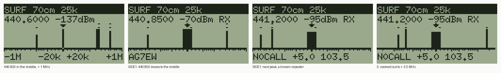

# Band surfing on the K6 (surf)

*2026-11-08.* Jeff's idea: a screen that shows signal strength across frequency as a bargraph,
the orange side keys jumping from peak to peak, UP/DOWN stepping along the frequency axis, and the
listening frequency drawn as a blinking bar with a caret above it.

**The lens scale (Jeff, 2026-11-09).** The listening frequency now always sits in the middle of
the screen and the scale moves with it. The scale is a lens: within +-20 kHz of the middle each
bin is 2.5 kHz wide (16 bins, a quarter of the screen), and further out each bin's step grows by
the same amount, so the last bin each side lands on the span (+-100 kHz to +-5 MHz, keys 1 and 3).
Each wide bin is the loudest of quick reads 20 kHz apart across its range, so a carrier between
two bin centres still shows. The lens's bins read with the narrow filter (Jeff: "narrow it a
bit"; 5 ms after the tune, as it settles more slowly), so a carrier fills about 5 of them, not 8.
An axis under the bars has ticks as on log paper (every 5 kHz to 20 kHz, 10 kHz to 100 kHz,
100 kHz to 1 MHz, then every 1 MHz; taller at 20 kHz, 100 kHz and 1 MHz), so the squeeze toward
the ends shows as ticks crowding together, and line 5 labels it: `-1M   -20k +20k   +1M`.
The code is now 5.3 KB (surfauto 5.5 KB), so it needs a voice image's 11,776 B module arena;
EXPLORE's 5,376 B is too small. Tested on the emulator only so far; the bench runs below are of
the earlier even 64-bin scale.

**Status: runs on the radio** (bench run 1, 2026-11-08, below). It is also tested on the emulated M0
against a modelled receiver and the real keypad matrix. It needs API level 6 (the module screen), so
it runs on the image already on the K6 (ffa7dbf, level 7) with no reflash: 3.8 KB of code in
the 4 KB store, receive only.



*Emulated screens, drawn pixel for pixel as the firmware's `draw_mod_screen` draws them
(`tools/k6_screen.py`): sweeping with 440.600 in the middle (+-1 MHz); SIDE1 jumped to the -70 dBm
carrier on 440.850, which moved to the middle and fills the lens's 2.5 kHz bins as wide as the
narrow filter, and the audio opened (RX); SIDE1 again, to 441.200, a repeater the explorer
saved, so line 5 gives its call, offset and tone (instead of the axis's labels); 3 zoomed out to
+-2.5 MHz (442.900 shows on the right). The dots in the top row mark saved repeaters.*

## Using it

Upload `mod-surf.bin` (CI builds it with the other modules) the usual way, for example
`tools/k6_upload.py mod-surf.bin --api-level 6 --key-file ~/.config/sotto/k6-mod.key`. It
starts on the band holding the pager's frequency (70 cm on the bench), centred on it.

| key | does |
|---|---|
| UP / DOWN | the middle one channel up / down (the band's step); held, it repeats. The scale moves with it, each bin keeping the level of the old one nearest it |
| SIDE1 / SIDE2 (orange) | next peak above / below that a settled read confirms (10 dB over the settled floor), on the channel raster; it moves to the middle, and the moved scale is swept once before the audio opens. If the loudest bin of the lens is then another channel, it moves there once more (a wide bin far out is coarse). With none left on screen, the scale's edge becomes the middle and it looks again after the sweep, on up the band until it finds one or reaches the band's edge ("no peak") |
| BAND or # | next band: 2m (144-148, 10 kHz), 1.25m (222-225, 10 kHz), 70cm (430-450, 25 kHz), GMRS (462.550-467.725, 12.5 kHz), MAR/WX (156.000-162.550, 25 kHz: marine and NOAA weather) |
| 1 / 3 | zoom in / out: the span +-100 kHz, 250 kHz, 500 kHz, 1 MHz, 2.5 MHz, 5 MHz (defaults: 2m and 1.25m 500 kHz, 70cm and MAR/WX 1 MHz, GMRS 2.5 MHz). The lens stays +-20 kHz |
| * | monitor: audio open on the bar all the time, no sweeping (title says MON) |
| 0 | hold: no refresh sweeps while a signal plays (title says HOLD) |
| MENU | says the bar's frequency and level on the serial port |
| EXIT | leave; the module waits for the key's release so the pager doesn't see it |

Screen: the title bar says the band and its channel step; line 1 the bar's frequency and its
level (a settled read, dBm) and RX while the audio is open; the bargraph (63 bins x 2 pixels on
the lens scale, the bar always in the middle under the caret, a tick over each peak, a dot in the
top row over each repeater the explorer saved, the axis and its ticks under the bars, nothing
past the band's edge); line 5 the axis's labels (`-1M   -20k +20k   +1M`), or with the bar on a
saved repeater its call, offset and TX tone (`N0CALL +5.0 103.5`), or "no peak" for 1.5 s.

**The lens.** Bin C+-k sits `off[k]` x 2.5 kHz from the middle: `off[k] = k` for k up to 8, then
`off[8+j] = 8 + j + (span - 31) * j(j+1) / (23 * 24)` for j = 1..23, so each step past the lens
is one more share than the last and bin 31 lands on the span. At +-1 MHz the steps grow from
2.5 kHz to about 75 kHz; at +-5 MHz to about 410 kHz. A bin wider than 20 kHz takes quick reads
20 kHz apart across its range (halfway to each neighbour) and keeps the loudest and where it was:
a jump goes to that frequency's channel, not the bin's centre.

## How it works

**One receiver, so it listens first.** While the bar's channel is quiet the module sweeps with
the audio muted. Every 16 bins it goes back to the bar for a settled read (12 ms after the
tune). A signal there 10 dB over the settled floor opens the audio (REG_47 FM and the speaker
amplifier on PB2, as `dmrdet`), and the module parks on it. It closes 1.5 s after the signal
drops and sweeps again. While parked, one refresh sweep every 5 s (about 0.3 s of muted audio)
keeps the bars current, unless hold is on.

**Levels.** Sweep reads are quick: 3 ms after the tune, like Aura's own spectrum. That is
about 59% of the way in dB from the -173 dBm restart (explorer Phase 0), so the bars are
relative. The floor is the quartile of the window's bins, one pixel is about 1.1 quick dB, and
a bar rises at once but falls at most 3 dB a sweep. A peak is a local maximum 6 quick dB over
the floor. The squelch and line 1 use settled reads against a settled floor: the second lowest
of 8 bins' settled reads, measured when the window changes and every 30 s of sweeping. A
quieter read of the bar lowers it. The AGC is left alone, because freezing the gain, as `dmrdet`
does, shifts RSSI by up to 15 dB.

**Speed (estimated from the emulator and Phase 0's ~0.9 ms tune).** A read costs about 3.9 ms.
At +-1 MHz a sweep is about 115 reads plus a check of the bar every 70 ms, about 0.5 s; at
+-5 MHz about 520 reads, 2 s; at +-100 kHz 63 reads, 0.3 s.

**Keys without a key API.** The module API has `key_down` but no key identity, so the module
scans Aura's matrix itself. The rows are PB0/PB4/PB10/PB11/PB9 and the columns
PC13/PC14/PF6/PB14; the side keys read with no row driven (Aura `src/device/keypad.rs` at
edf3b98). It writes only the row bits' BSRR/BRR, as `key_poll` does, and leaves the rows idle.

**Saved repeaters.** At the start the module reads the explorer's repeater table (c/k6/rt.h,
0x0F0000, level 5's `fl_read`, 8 bytes a slot, about 0.1 s) and keeps the frequency and slot of
up to 24 valid records. With the bar on one it reads that record's call, offset and TX tone for
line 5. It never writes the flash. This is the first piece of the VFO idea below: the bargraph
knows which peaks are repeaters, and PTT could later use the offset and tone it shows.

**Memory.** The 480 B bitmap, the ~1 KB state (the bins' frequencies and loudest-read places)
and a move's copy of the old scale are on the stack (`-fstack-usage`: about 2.1 KB deepest, of the
3 KB a module has at its call on the voice images and 6.7 KB on EXPLORE). The code is 4.8 KB
(surfauto 5.1 KB) before the axis and the narrow lens, 5.3 KB (5.5 KB) after: it needs the voice
images' 11,776 B module arena (EXPLORE's is 5,376 B).

## Bench build (surfauto)

`mod-surfauto.bin` is the same module for unattended runs: SIDE1 presses itself every 4 s. Each
peak it jumps to says `sel <MHz> <dBm> <floor>`: the settled read that confirmed it and the
settled floor it beat by 10 dB (runs 1 and 2 said the bar's level 4 s later, before the jump). It wraps to the band's bottom at the top and leaves after 60 s. The keys
still work. Before it ends it says its last bargraph: `bar <middle MHz> <span> lens` (before the
lens: `bar <first bin MHz> <step>`), then two
lines of 32 letters, one a bin, `a` for 1 pixel up to `x` for 24 (about 112 bytes of the 684 the
telemetry carries). `python tools/k6_screen.py RUN.txt OUT.png` draws it as the screen showed
it, so a run's spectrum comes back with no serial log. With `--telemetry 12` the K6 sends those lines back over the air, so the bench needs
no one at the radio and no serial cable:

```
tools/k6_upload.py mod-surfauto.bin --api-level 6 --telemetry 12 --run-s 70 --key-file ~/.config/sotto/k6-mod.key
```

A run on the bench should list the active 70 cm repeaters (441.000, 441.100, 441.200, 440.925
DMR when up). For a known peak, the IC-7100 can send PSK31 `AG7EW TEST` on a free 70 cm
frequency during the run (`modem/psk31.py`), back on 440.850 before the module ends so the
report gets through. In the emulator (tests/test_k6_surf.py) it finds 440.850, then 441.200,
wraps from 450 to 430, then finds 430.300 and the others again.

## Bench run 1 (2026-11-08 08:08Z, hamlet, receive only)

`mod-surfauto.bin` (CI 5877cc6) went up by `tools/k6_upload.py` on 440.850. All 30 XL chunks
arrived on the first send. It ran 60,053 ms, returned 5 (sweeps), and had 2,128 B of stack
free. Its 13 `sel` lines came back over the air:

```
surf 70cm 440.850 25k
sel 440.8500 -35      the IC-7100 still keyed after the upload
sel 440.9250 -103     sel 440.9750 -103     sel 441.0750 -110     sel 441.1250 -108
sel 441.5500 -103     sel 441.6250 -107     sel 441.8000 -118     sel 441.8500 -122
sel 441.9250 -104     sel 442.2000 -104     sel 442.3250 -104     sel 442.4250 -103
end sw=5
```

What it showed:
- The module, the screen calls and the keypad scan run on the real image, and the stack has
  room to spare.
- **The side keys stopped on noise.** Each peak was a bump in the quick reads that a settled read
  put at only -103 to -122 dBm, so the climb took 13 presses to reach 442.4 and never wrapped.
  Each of those bumps opened the squelch, so the module spent most of the run parked, which is why
  it made only 5 sweeps. Fix (the PR after #143): a candidate peak counts only when a settled read
  puts it 10 dB over the settled floor (12 ms a candidate). The emulator now has bumps that show
  only in quick reads (`test_side_keys_skip_bumps_a_settled_read_doesnt_confirm`), and the old
  code fails that test.
- No serial log: auto mode refused the read-only logger, so the run's bargraph itself isn't
  recorded. Next run: allow `k6_harness listen` on ttyUSB2 (read-only) or watch the screen.

## Bench run 2 (2026-11-08 16:3xZ, hamlet, receive only)

`mod-surfauto.bin` from main bf7990a (#153) went up on 440.850: 69 of 69 chunks on the first
pass. It ran 60,051 ms, returned 9 sweeps (5 in run 1), and had 5,040 B of stack free.

```
surf 70cm 440.850 25k
sel 440.8500 -25      the upload's own carrier: the IC-7100 was still sending
sel 440.9250 -97      sel 441.0250 -113     sel 441.0750 -108     sel 441.1250 -112
sel 441.9500 -116     sel 442.0000 -104     sel 442.0750 -130     sel 445.3000 -102
bar 447.2500 25k
aaaaaaaaaaaaaaaabaaaaaaaaaaaaaaa
aaaaaaaaaaaaaaaaaaaaaaaaaaaaaaaa
end sw=9
```

What it showed:
- The bargraph telemetry works end to end: `tools/k6_screen.py` drew the last window
  (447.250-448.825), flat but for one bin a pixel up at 447.650. The climb ended up there,
  where nothing is on the air and no saved repeater falls, so no marks showed.
- The settled-read confirm made the climb go further (9 jumps to 445.3 against 13 to 442.4) and
  sweep more. 440.925 at -97 is the DMR repeater.
- The levels can't be judged yet. Each `sel` said the bar's level when the next press came 4 s
  later, not the read that confirmed it, and not the floor it beat. A -130 on 442.075 means
  that channel had dropped by then. The build after run 2 says the confirming read and the
  floor at the jump, and drops the line for the starting bar, which caught the upload carrier.
  Run 3 can then tell whether the -108 to -116 stops are short signals or a floor read too low.

## The bargraph as the radio's main VFO? (Jeff's thought, 2026-11-08)

It fits, and this module is the way to try it. Points for and against:

- **Listening comes first, which a VFO must do.** The module never sweeps while a signal plays
  on the bar, except for the refresh, which hold turns off. So as a VFO it behaves like a normal
  receiver with a live spectrum whenever the channel is quiet. A single-receiver radio can't
  do better. The cost is that the bars go stale during a long QSO.
- **Fit with Aura.** The pager-only and EXPLORE images already drop Aura's standby screen and
  menus, so the surf screen could be their home screen, with no change to stock Aura. As a flash
  feature it is about 3 KB of C, and the EXPLORE image has about 14 KB of flash to spare (108.9
  of 122.9 KB). It draws straight into Aura's display buffer, so the bitmap goes away. RAM is the
  64-byte bar array and about 200 B of state.
- **What a VFO adds:** PTT on the bar, which the module API can't do. TX belongs in the core
  with its band lock. The repeater table (c/k6/rt.h) gives offset and tone, so PTT on a known
  repeater's output keys its input. Frequency entry by digits and a squelch setting are the
  other additions.
- **Suggested path:** run `surf` on the radio first, so Jeff can judge the feel (sweep rate,
  blink, how stale the bars get while listening). If he likes it, move the C core into the
  EXPLORE image as its home screen, with EXPLORE's candidate list one key away and PTT through
  the repeater table. Combined with the planned page-buffer screen, it can replace the EXPLORE
  list screen.

## Files

- `c/k6/mod/surf.c`: the module; `c/k6/mod/surfauto.c`: the bench build.
- `tests/test_k6_surf.py`: the emulated runs (the lens's steps, bargraph, side keys, UP/DOWN
  moving the scale, the axis's ticks and labels, band and zoom, the band's edge, monitor, squelch hang, EXIT, saved
  repeaters from a table in the emulated flash, the bench build and its bargraph lines). `python tests/test_k6_surf.py OUT.png`
  redraws the screens above.
- `tools/k6_screen.py`: draws any level-6 module's emulated frames as the LCD shows them, and
  (run as a script) the bargraph a surfauto run said.
- `tests/test_k6_i2s.py`: `run(..., keypad=[(from_us, to_us, key)])` drives the real key matrix
  for modules that scan it.
